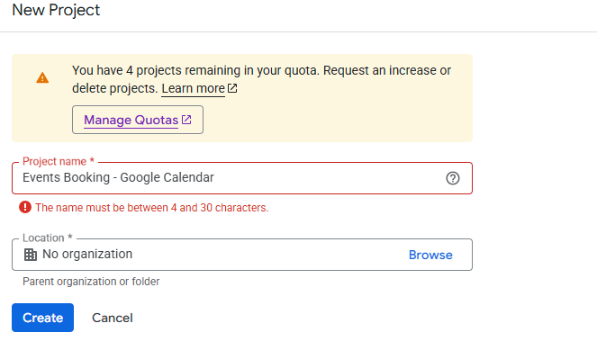
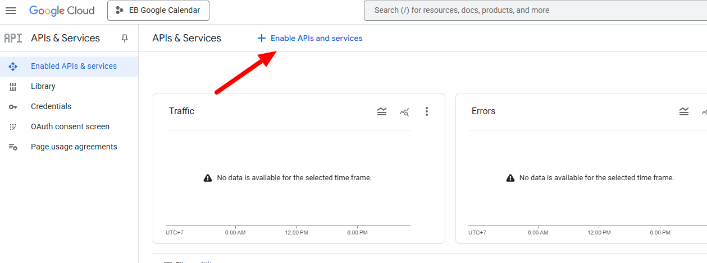
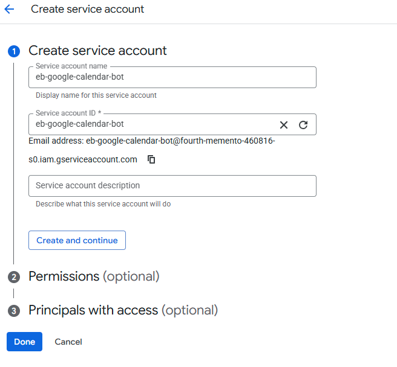
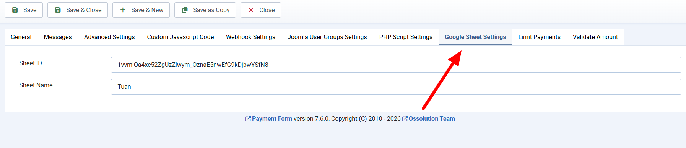

If you want to synchronize payment records of your forms automatically to Google Spreadsheets, you can use **Payment Form - Google Spreadsheet** plugin. This is a paid add-on, it does not come with Payment Form package, and need to be purchased separately. Go to https://joomdonation.com/joomla-extensions/joomla-payment-form.html , look at Paid Add-ons tab, see and purchase the plugin from there. Download, install it and then go to **System** -> **Plugins**, find and enable the plugin to use the integration. There are few setup steps needed for the synchronization to work:

### Create a Google Cloud Project
1. Go to the [Google Cloud Console](https://console.cloud.google.com/).
2. Click **Select a project** → **New Project**.
3. Enter a name (e.g., `Payment Form - Google Spreadsheet`) and click **Create**.

### Enable the Google Sheets API

1. Access to the project, then click on  **Enable APIs and services**
2. Search for **Google Sheets API**.
3. Click **Google Sheets API** → **Enable**.

### Create a Service Account

1. Go to **IAM & Admin** > **Service Accounts**.
2. Click **+ CREATE SERVICE ACCOUNT** at the top.
3. Fill in the following:
   - **Service account name**: (e.g., `eb-google-calendar-bot`)
   - Click **Create and continue**.
4. In the **Grant this service account access to the project** step, skip assigning roles and click **Continue**, then **Done**.

### Create and Download a JSON Key File
1. Find your new service account in the list and click on its name.
2. Go to the **Keys** tab.
3. Click **Add Key** → **Create new key**.
4. Choose **JSON** format, then click **Create**.
5. A `.json` key file will be downloaded to your computer. **Keep this file safe!**
6. Rename the downloaded json file to be **service-account.json**, upload that file to **plugins/pmform/googlesheet/credentials** folder on your site.

### Share Your Google Spreadsheet with the Service Account
To allow the system to write data into your Google Sheet, you need to share the sheet with the service account just like you would with any collaborator.

1. Open your Google Sheet in your browser.
2. In the top right corner, click the **Share** button.
3. In the “Add people and groups” field, paste the service account email provided to you. It looks something like this **your-service-account@your-project.iam.gserviceaccount.com**
4. Click **Add people** and enter your service account’s email (e.g., `joomla-calendar-bot@your-project.iam.gserviceaccount.com`).
5. Make sure the permission is set to **Editor**.
6. Click **Send** or **Share** to save.

### Configure Google Sheet Settings for each event

Payment records from each form will be synchronized to a separate sheet. So you if you want payment records of certain form to be synchronized to your Google Spreadsheet, edit the form, look at **Google Sheet Settings** tab, enter Sheet ID and Sheet Name there. Then payment records of that form will be synchronized to that sheet. Keep in mind that each form needs a separate sheet to store payment records.

#### How to get Sheet ID

1. Open your Google Sheet in your web browser.

2. Look at the URL in your browser’s address bar. It will look something like this:

https://docs.google.com/spreadsheets/d/1A2B3C4D5E6F7G8H9I0Jabcdefg123456/edit#gid=0

3. The **Sheet ID** is the long string of letters and numbers **between** `/d/` and `/edit`: . In this example , it is **1A2B3C4D5E6F7G8H9I0Jabcdefg123456**

#### How to get Sheet Name

1. Look at the bottom of your Google Sheet window.

2. You’ll see one or more **tabs** like this:

*(Example tab names: Sheet1, Leads, Orders, etc.)*

3. The name of the tab you want to use is the **Sheet Name**.

> By default, this is often called `Sheet1`, but you or someone else may have renamed it.

4. You can rename the tab by **double-clicking** it and entering a new name (e.g. `Leads`, `Orders`, or `ContactForm`).