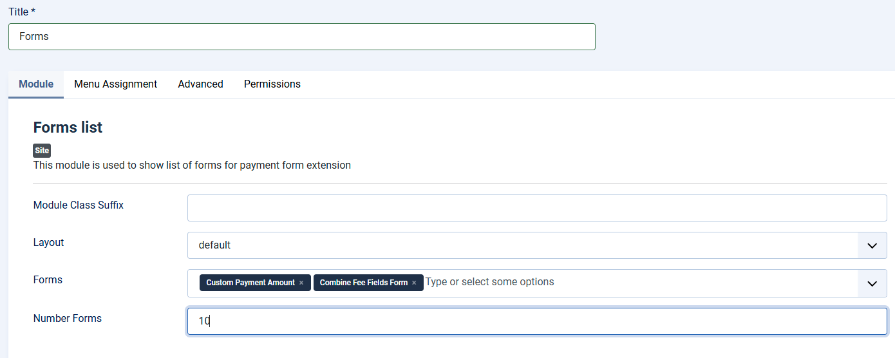

The **Payment Form - Forms List** module allows you to display list of forms in a module position. If you want to use this module, go to System -> Site Modules, find and create an instance **Payment Form - Forms List** of the module and assign it to the position you want. The module has following important parameters:

- **Forms**: Select the forms you want to display here. If no forms are selected here, all published forms will be displayed.
- **Number Forms**: Enter number of forms you want to be displayed in the module

