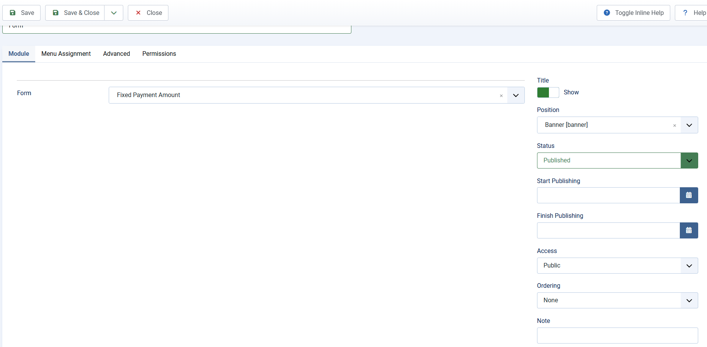

The **Payment Form - Form** module allows you to display a form in a module position. If you want to use this module, go to System -> Site Modules, find and create an instance **Payment Form - Form** of the module and assign it to the position you want. The module has following important parameters:

- **Form**: Select the form you want to display here

