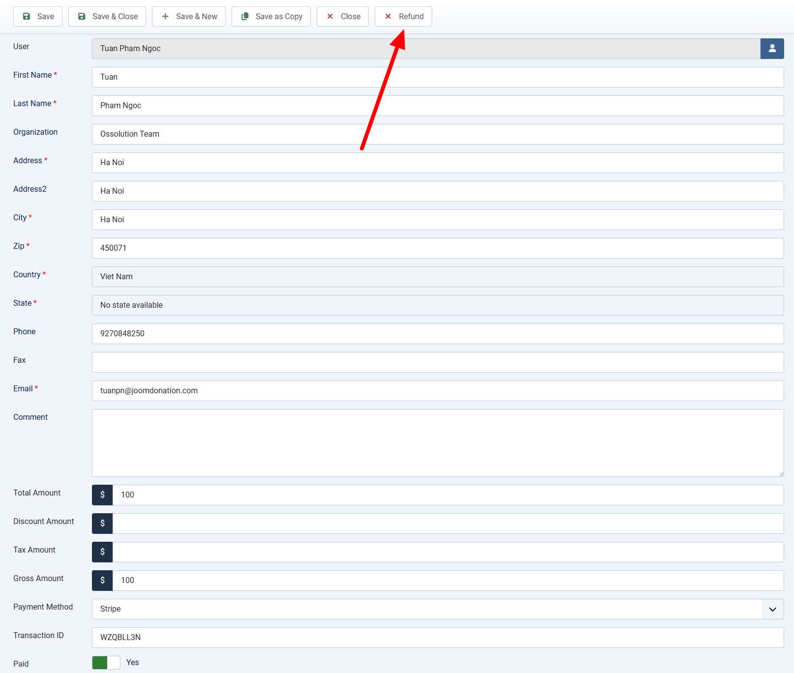

## Refund Payment
If you one of payment methods support refund payment like PayPal (require configure Advanced parameters), Stripe, Stripe Checkout, Mollie, PayPal, you can refund payment directly from administrator area of your site. To do that:

- From payments management screen, click on the payment record you want to refund
- On payment edit screen, click on **Refund** button

That will process refund for payment record. You do not need to login to payment gateway to find the transaction any process refund.

