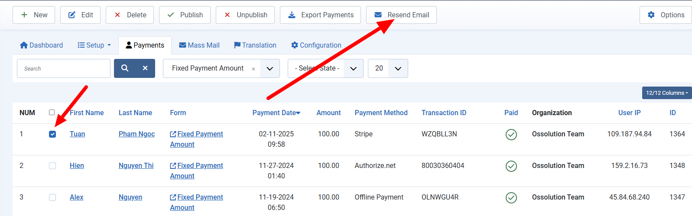

Sometime, you might want to resend confirmation email to user (the email which received when process payment using the form). For example, if they did not receive email for some reasons or if you update data of payment record and resend email to them. For that :

- From Payments management screen, check on the checkbox next to registration record
- Press **Resend Email** button in the toolbar

The system will resend confirmation email to user and notification email to administrator (the same email when user makes payment using your form)

