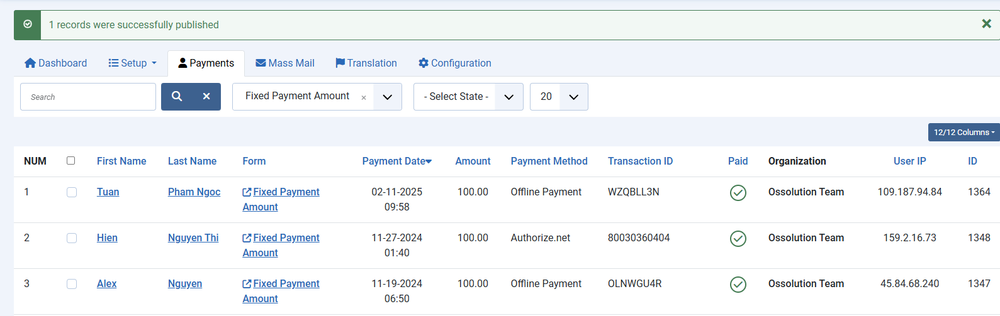

In Joomla's administrator area, go to **Components → Payment Form → Payments**. You can also open **Payments** from the Payment Form dashboard.

## Find a payment

- Search by first name, last name, email address, or transaction ID. To search by the number in the **ID** column, enter a search such as `id:123`.
- Use **Select Form** to narrow the list to a published form. Under **Select State**, **Published** shows paid records and **Unpublished** shows pending records. Clear the status filter to see refunded records, which display a **Refunded** badge.
- The **Payment Date** column shows when the record was created. For an offline payment, this is usually when the customer submitted the form.
- If an unfinished online payment is missing, check **Show Incomplete Payment Records** under **Payment Form → Configuration → General**. Pending offline payments appear with either setting. See [General configuration](/getting-started/configuration/general).
- To display a custom field as a column, edit the published field and set **Show On Payments List** to **Yes**. For supported choice fields, also set **Filterable** to **Yes** to filter payments by an option. See [Custom field settings](/basic-setup/custom-fields/add-new-custom-field).

## Add, edit, or delete a record

- **Add a manual payment.** Select the form first, then click **New**. Enter the customer details and amounts, including **Total Amount** and **Gross Amount**. The editor defaults to **Paid** set to **Yes** and selects **Offline Payment** if that method is published. To record a payment you are still waiting for, choose an offline method and set **Paid** to **No**. Saving creates a local record, sends the configured payment emails, and runs any payment-success integrations if the record is paid.
- **Edit a payment.** Click the payer's first or last name, or select the record and click **Edit**. Saving an online payment sets its status to **Paid**. Verify a pending transaction at the gateway before saving it. Review refunded records from the list to preserve their status.
- **Delete a record.** Select its checkbox and click **Delete**. This removes the payment record and its saved custom field values from Payment Form. To return money through the gateway, use [Refund Payment](/payments-management/refund-payment).
- **Download an invoice.** When invoices are enabled and a record has an invoice number, click the number in the **Invoice Number** column to download the PDF. See [Invoice Settings](/getting-started/configuration/invoice-settings).

## Payment actions

- Record receipt of a bank transfer or other offline payment. [Approve Payments](/payments-management/approve-payments)
- Download records for reporting or reconciliation. [Export Payments](/payments-management/export-payments)
- Send an announcement to customers of one form. [Mass Mail](/payments-management/mass-mail)
- Return a payment through a supported gateway. [Refund Payment](/payments-management/refund-payment)
- Send the usual payment emails again for selected records. [Resend Email](/payments-management/resend-email)
