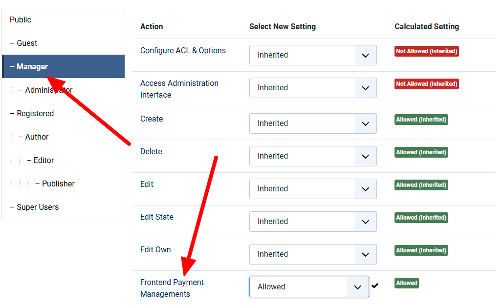
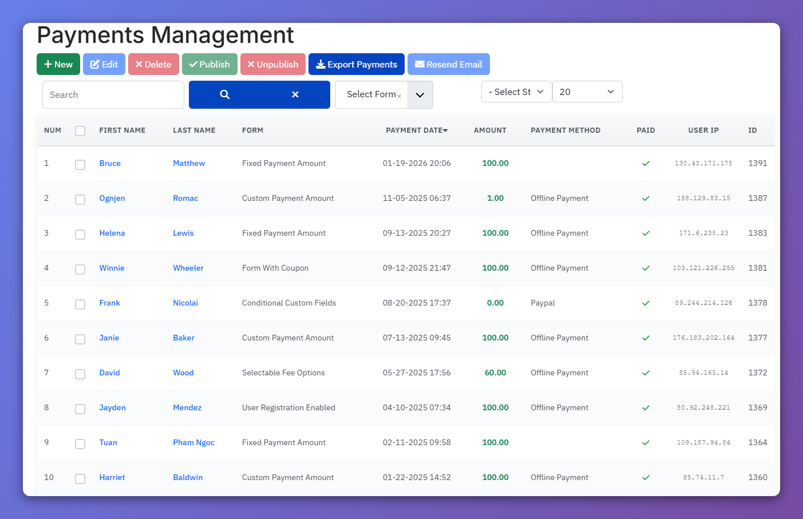

Frontend Payment Management brings administrative payment functionality to your site's frontend, enabling designated users to:

- View and search payment records
- Add new payment records manually
- Edit existing payment details
- Approve pending payments
- Process refunds through payment gateways
- Export payment data to CSV
- Resend confirmation emails to customers

This feature can is useful in case you want to allow clients to manage payments without backend access.

## Setting Up Permissions

From any page in Payment Form backend (for example, Payments Management), click on Options button in the toolbar, then select user group which you want to allow manage payments from frontend of your site, set **Frontend Payment Managements** to **Allowed**. You should also set **Create**, **Edit**, **Edit State** and **Delete** permissions for this user group to Allowed so that they can create new payment record, edit payment record , change status and delte payment records.

## Create Frontend Menu Item

Next step is create a menu item. You need to create a menu item to link to **Payments Management** menu item type of **Payment Form** to allow the users (with **Frontend Payment Managements** permission configured above) to access and manage payments from frontend of your site.

