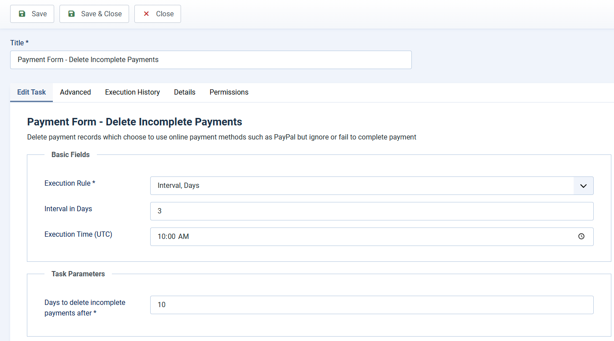

Use this task to remove old pending online payment records, such as those left when a customer abandons a PayPal checkout or a card payment fails. The task applies to all forms and excludes offline payment methods such as bank transfer.

## Configure the task

1. [Create a scheduled task](/scheduled-tasks#create-a-scheduled-task) of type **Payment Form - Delete Incomplete Payments**.
2. Under **Basic Fields**, set **Interval in Days** to **3** to check for incomplete payments every three days, or choose a schedule that suits your site.
3. Under **Task Parameters**, set **Days to delete incomplete payments after**. The default is **20 days** and the minimum is **5 days**. The task measures age from the date the payment record was created. Allow enough time for your online payment methods to confirm transactions that are still pending.

