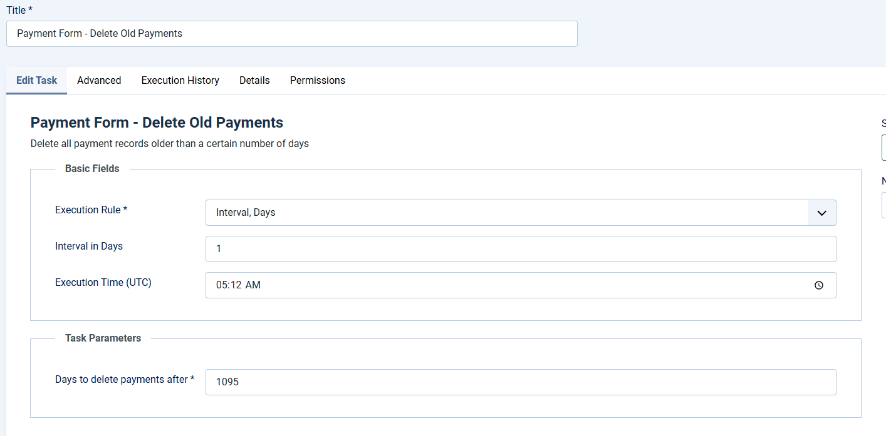

Use this task when you only need to keep payment records for a defined period. It permanently deletes eligible records across all forms, including paid, pending, and refunded payments. If you only want to remove unfinished online payments, use [Delete Incomplete Payments](/scheduled-tasks/delete-incomplete-payments).

Back up your Joomla database before enabling the task. If you need copies for reporting or reconciliation, [export those payments](/payments-management/export-payments) before the first run.

## Configure the task

1. [Create a scheduled task](/scheduled-tasks#create-a-scheduled-task) of type **Payment Form - Delete Old Payments**.
2. Under **Basic Fields**, set **Interval in Days** to **3** to run the cleanup every three days, or choose a schedule that suits your site.
3. Under **Task Parameters**, set **Days to delete payments after**. The default is **1,095 days** (about three years) and the minimum is **1 day**. On each run, the task deletes records created at least that many days ago. Use the **Payment Date** column in **Payment Form → Payments** to check when records were created.

